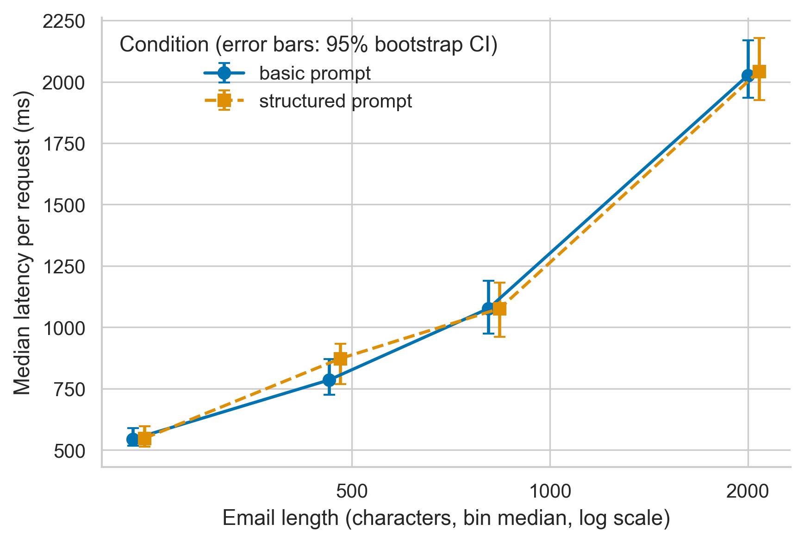
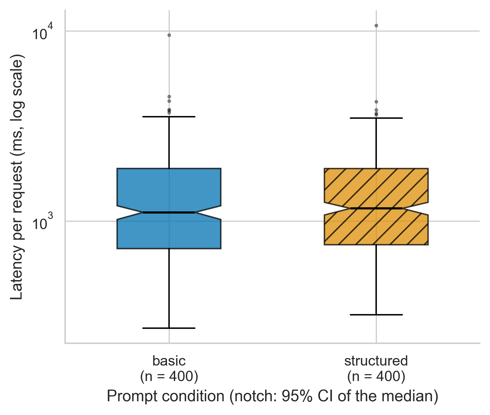
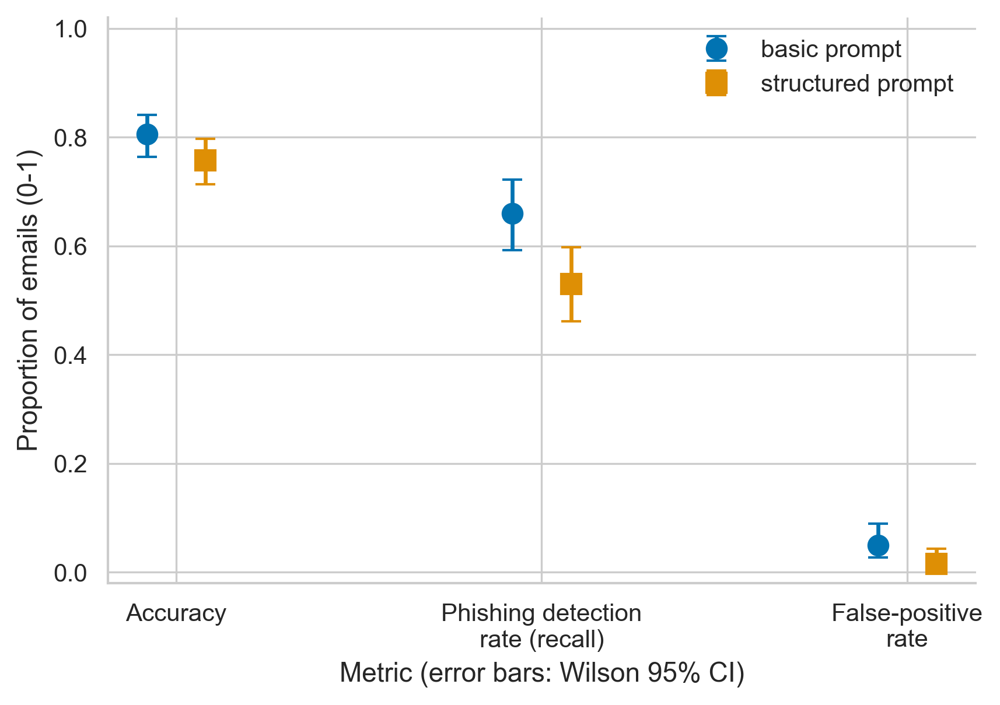

# The Effect of Prompt Design on AI-Based Phishing Email Detection

**Author:** Orazgeldy Nurdaulet  
**Research type:** Quantitative comparative experiment  
**License:** MIT

## Overview

This project compares a basic prompt and a structured prompt for classifying emails as phishing or legitimate. Both prompts are tested with the same local language model and the same labeled emails.

**Research question:** Does prompt design affect the accuracy, phishing detection rate, and false-positive rate of an AI model classifying emails?

**Hypothesis:** The classification results will differ between the basic and structured prompt conditions. The null hypothesis is that the results will not differ.

## Repository structure

```text
configs/config.json         Smoke-test settings (8 synthetic emails) and prompt definitions
configs/config_eval.json    Settings for the final experiment (balanced public-dataset sample)
data/sample/emails.csv      Eight synthetic emails for a smoke test
data/sample/emails_eval.csv Balanced evaluation sample drawn from a public dataset (created by prepare_dataset.py)
data/external/              Downloaded public dataset (not committed)
data/raw/test_run.jsonl     Raw benchmark log: one record per request, warm-up and evaluation
data/processed/             Aggregated metrics and statistical tests (CSV)
docs/methodology_card.md    Methodology passport card
docs/domain_model.md        C4 domain model with metric collection points
notebooks/01_data_analysis.ipynb  Reproducible analysis notebook
reports/figures/            Figures as PDF (vector) and PNG (300 DPI)
src/benchmark.py            Runs both prompt conditions, times every request, writes the raw log
src/prepare_dataset.py      Builds the balanced, reproducible evaluation sample
src/process_data.py         Drops warm-up, computes metrics, confidence intervals, McNemar tests
src/visualize.py            Publication-ready figures
tests/                      Unit and end-to-end tests
environment.yml             Pinned Conda/Python environment
requirements.txt            Pinned Python packages
```

## System requirements

- macOS, Windows, or Linux
- Python 3.9 or later (the pinned libraries support Python 3.9 to 3.12)
- Ollama installed and running locally
- About 2 GB free disk space for the `llama3.2:3b` model

The model is served locally by Ollama. No API key is required. The model tag and generation settings are recorded in the configuration.

The reproducible Conda environment pins Python 3.12.8 and the Python dependencies. Create it with `conda env create -f environment.yml` and activate it with `conda activate phishing-prompt-benchmark`.

## Quickstart (smoke test)

1. Install Ollama from [ollama.com/download](https://ollama.com/download), open it, then download the model:

```bash
ollama pull llama3.2:3b
```

2. In the repository folder, create and activate a Python environment and install the pinned dependencies:

```bash
python3 -m venv .venv && source .venv/bin/activate && python -m pip install -r requirements.txt
```

3. Run the sample benchmark:

```bash
python src/benchmark.py --config configs/config.json
```

The script saves `results/predictions.csv`, `results/summary.json`, and a raw log with per-request latency. The sample output is a pipeline check only; it is not a final research result.

Run the unit tests with `python -m unittest discover -s tests`. The end-to-end tests use a fake local server, so they do not need Ollama or a model.

## Running the final experiment

1. **Get the public dataset.** Download `Phishing_Email.csv` from the [zefang-liu/phishing-email-dataset](https://huggingface.co/datasets/zefang-liu/phishing-email-dataset) page (a copy of the Kaggle dataset "Phishing Email Detection"; the dataset card states the LGPL-3.0 license) and save it as `data/external/Phishing_Email.csv`.
2. **Create the evaluation sample.** This removes empty, very short, duplicate, and conflicting-label texts, draws a class-balanced sample with seed 42, and truncates long emails:

```bash
python src/prepare_dataset.py --input data/external/Phishing_Email.csv --output data/sample/emails_eval.csv --per-class 200 --seed 42 --max-chars 2000
```

3. **Run the benchmark** (3 warm-up requests per condition, then every email under both prompts). Finished records are saved immediately; if the run is interrupted, continue it with `--resume`:

```bash
python src/benchmark.py --config configs/config_eval.json
python src/benchmark.py --config configs/config_eval.json --resume
```

4. **Process the raw log and build figures**, then update the results table below:

```bash
python src/process_data.py --raw data/raw/test_run.jsonl --update-readme
python src/visualize.py --raw data/raw/test_run.jsonl
```

5. **Open the notebook** `notebooks/01_data_analysis.ipynb` and run *Kernel -> Restart & Run All* so that all outputs are saved in the file.

## Metrics

| Metric | Role | Formula |
|---|---|---|
| Phishing detection rate (recall) | Primary | TP / (TP + FN) |
| Accuracy | Guardrail | (TP + TN) / N |
| False-positive rate | Guardrail | FP / (FP + TN) |

The basic prompt is the baseline. Both conditions are evaluated on the same emails. Proportions are reported with Wilson 95% confidence intervals. Because both prompts see the same emails, the prompts are compared with an exact McNemar test, with a Bonferroni correction for the three hypotheses. Request latency is reported as median (p25-p75), p95, p99 and mean +/- SD after discarding warm-up requests.

## Results & Discussion

The table below is generated by `python src/process_data.py --update-readme` from the raw log. It is empty until the final experiment has been run.

<!-- RESULTS:START -->

| Metric | basic (95% CI) | structured (95% CI) | McNemar p (Bonferroni) |
|---|---|---|---|
| Accuracy | 0.805 [0.763, 0.841] | 0.757 [0.713, 0.797] | 0.013 |
| Phishing detection rate (recall) | 0.660 [0.592, 0.722] | 0.530 [0.461, 0.598] | 0.000 |
| False-positive rate | 0.050 [0.027, 0.090] | 0.015 [0.005, 0.043] | 0.117 |

| Latency per request (ms) | n | Median (p25-p75) | p95 | p99 | Mean +/- SD |
|---|---|---|---|---|---|
| basic | 400 | 1109 (715-1887) | 2909 | 3815 | 1376 +/- 891 |
| structured | 400 | 1163 (749-1886) | 2954 | 3628 | 1420 +/- 924 |

<!-- RESULTS:END -->

### Figures







Vector versions of all figures are saved next to the PNG files as PDF.

### Domain model

The C4 model of the benchmark system, with the metric collection points M1-M5, is in [docs/domain_model.md](docs/domain_model.md).

### Limitations

- One small local model (`llama3.2:3b`) and one public dataset: results do not automatically generalize to other models, languages, or phishing types.
- Long emails are truncated to the configured number of characters, so the model sees at most that much text.
- Latency is measured on one machine and depends on its hardware; only the comparison between the two prompts, measured in interleaved order, is meaningful.
- An `invalid` model answer on a phishing email counts as a missed phishing email. In the confidence intervals and tests an `invalid` answer on a legitimate email counts as not a false positive, and the number of `invalid` answers is reported with every result.
- Record the Ollama version and model digest (saved automatically in `data/raw/run_metadata.json`) when reporting results.

## Citation and license

The code is released under the MIT License. The messages in `data/sample/emails.csv` are synthetic. `data/sample/emails_eval.csv` is a sample derived from the public dataset named above; follow that dataset's license and attribution terms when reusing it. Cite this project as:

```text
Nurdaulet, O. The Effect of Prompt Design on AI-Based Phishing Email Detection. GitHub repository, 2026.
```
