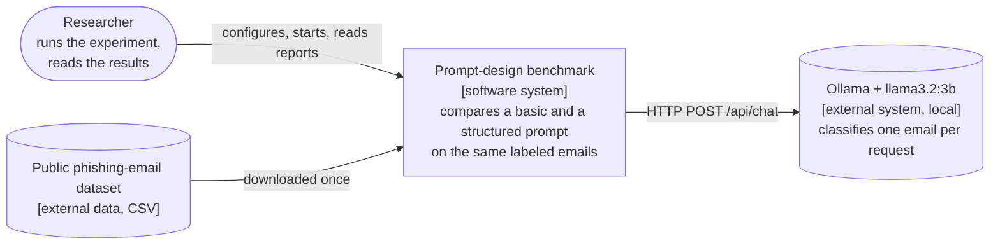
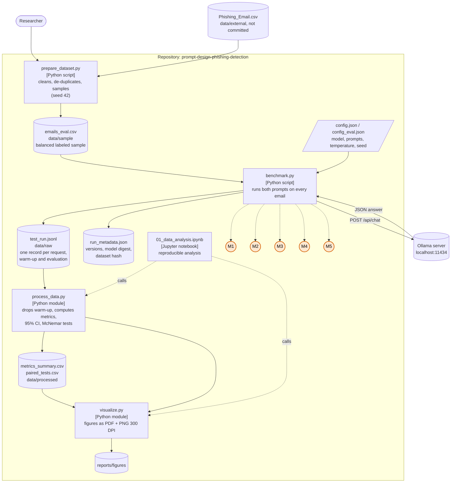
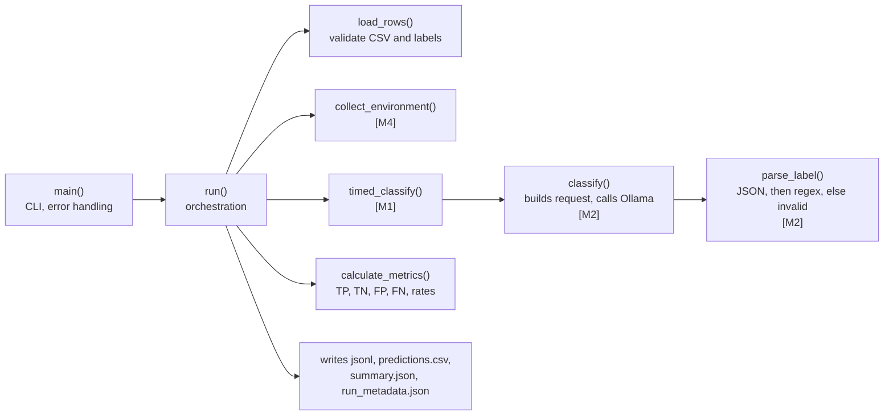

# Domain Model (Software Engineering track)

This document describes the benchmark system as a C4 model and marks the **metric
collection points** (M1-M5): the places in the code where measurements are taken.
Diagrams are written in [Mermaid](https://mermaid.js.org/) and render on GitHub.

## 1. System context (C4 level 1)

## 2. Containers and metric collection points (C4 level 2)

### Metric collection points

| ID | Where (function in `src/benchmark.py`) | What is measured | Stored as |
|---|---|---|---|
| **M1** | `timed_classify` wraps the HTTP request to Ollama with `time.perf_counter()` | Latency of one classification, in milliseconds | `latency_ms` in `test_run.jsonl` |
| **M2** | `classify` and `parse_label` | Raw model answer and the label parsed from it (`phishing`, `legitimate`, or `invalid`) | `raw_response`, `predicted_label` |
| **M3** | `run` (`len(email_text)`) | Size of the input email in characters | `email_chars` |
| **M4** | `collect_environment` | Python and platform, Ollama version, model digest, temperature, seed, SHA-256 of the dataset file | `run_metadata.json` |
| **M5** | `run` (`utc_now`) | Time of every request, plus the `phase` (`warmup` or `eval`) | `timestamp_utc`, `phase` |

Warm-up requests (`phase = warmup`) include loading the model into memory and are
stored but excluded from all statistics by `process_data.split_warmup`.

## 3. Components of `benchmark.py` (C4 level 3)

Design decisions that protect validity:

- **Same inputs for both prompts.** Every email is sent under both conditions; only the user prompt differs.
- **Interleaving and alternating order.** Conditions are interleaved per email and their order alternates, so slow drift in machine speed does not favor one prompt.
- **Isolated requests.** Each request is stateless: no chat history is shared between emails.
- **Incremental writes.** Every record is flushed to disk immediately, and `--resume` continues an interrupted run without repeating finished emails.

## 4. Data model of one raw record

| Field | Type | Meaning |
|---|---|---|
| `phase` | string | `warmup` or `eval` |
| `condition` | string | `basic` or `structured` |
| `id` | string | Email identifier from the dataset sample |
| `true_label` | string | Ground truth: `phishing` or `legitimate` |
| `predicted_label` | string | Model decision: `phishing`, `legitimate`, or `invalid` |
| `raw_response` | string | Unmodified model output |
| `latency_ms` | number | Request duration in milliseconds |
| `email_chars` | integer | Email length in characters |
| `timestamp_utc` | string | ISO 8601 time of the request |

## 5. Threats to validity (summary)

| Threat | Mitigation in this design |
|---|---|
| Latency affected by model loading | Warm-up records are separated and discarded |
| Order effects (thermal throttling, caching) | Conditions interleaved, order alternated |
| Random generation | `temperature = 0`, `seed = 42` |
| Unclear software state | Versions, model digest, and dataset hash recorded (M4) |
| Ambiguous labels in the dataset | Texts that carry both labels are removed in `prepare_dataset.py` |
| One small model, one dataset | Stated as a limitation; results are not generalized |
